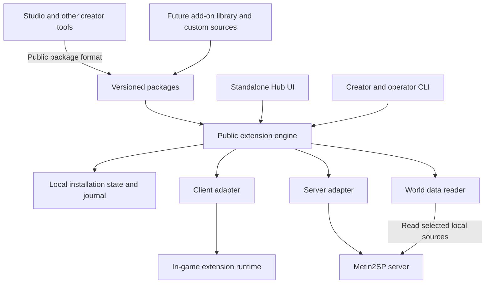

# Foundation architecture

Status: proposed design. Interface names and layouts below describe intended contracts; they are not released commands or existing Metin2SP APIs.

The [minimal game integration decision](MINIMAL_GAME_INTEGRATION.md) narrows the first implementation: one local game adapter, one client module entry convention, one quest resource type and fixed local ownership. The broader possibilities below are not all prerequisites for the first real add-on.

Hub owns the extension lifecycle. Metin2SP owns gameplay, the base installation and official updates. Studio and future creator tools consume the same public SDK. Nothing in Hub requires Studio's source, service, database or credentials.

## Components and dependency direction



| Component | Owns | Must not depend on |
| --- | --- | --- |
| Package engine | Manifest validation, dependency resolution, immutable package objects, ownership and plans | UI framework, game assets or Studio |
| Installation coordinator | Target identity, cross-process lock, adapter selection, transaction journal and receipts | A particular editor or catalog |
| Client adapter | Build detection, pack/loader composition, verification and restoration | Server credentials |
| Client runtime | Module loading, lifecycle, windows, shortcuts and bounded preferences | A running Hub, network catalog or privileged server access |
| Server adapter | Supported quest/content/config operations, compilation, restart and health evidence | Studio objects or package-supplied unrestricted installer scripts |
| World data reader | Structured, provenance-labelled reference snapshots | Editor drafts or implicit live-game mutation |
| Source providers | Local ZIP, HTTPS index and public GitHub release retrieval | Installation side effects during discovery/download |
| Hub service and UI | Local authentication, presentation, jobs and progress | Duplicate package or deployment logic |
| SDK | Schema, scaffolding, validation, deterministic packaging and synthetic examples | Private source or credentials |

Start as one modular Python application/library plus CLI and a local browser UI. There is no need for distributed services or an always-running gameplay backend. Keep the embedded client runtime compatible with its actual game interpreter; its supported Python syntax is independent of the host runtime.

HACS informs the source/manifest/release workflow. AzerothCore informs the separation of modules and core through documented hooks. Metin2SP's protected server distribution requires adapters and supported scripting interfaces rather than assuming core recompilation. [HACS manifests](https://www.hacs.xyz/docs/publish/start/), [AzerothCore module boundaries](https://www.azerothcore.org/wiki/the-modular-structure), [Metin2SP distribution](https://github.com/TieruYT/metin2-playerbots/blob/main/README_EN.md).

## Package contract

One package has a stable namespaced ID and an immutable released version. It can declare a client component, a server component or both. Each component declares its adapter, API requirements and resources; the engine resolves the complete package graph before installation.

The manifest contract must cover:

| Field group | Required meaning |
| --- | --- |
| Identity | Format version, package ID/version, display name, publisher label and license |
| Components | Client/server entry points and supported adapter operations |
| Compatibility | Host/runtime/adapter API ranges, required capabilities and tested game builds |
| Relationships | Dependencies with version constraints, conflicts and explicit replacement/migration declarations |
| Payload | Declared files, bounded sizes, hashes and destinations within allowed namespaces |
| Configuration | Typed schema, defaults, scope and settings migration |
| Ownership | Files, config keys, quest names, content IDs and any supported persistent resources |
| Lifecycle | Restart/downtime requirements, enable/disable behaviour, cleanup and data-retention policy |
| Provenance | Release artifact digest, source identity, source revision and release notes |

Do not overload the existing client API number to represent server deployment or package syntax. Version the package format, host engine API, embedded client API, server adapter API and reference-data schema independently. Freeze the exact JSON schema at M1; do not publish a sample that appears executable before the validator implements it.

Legacy client packages need an explicit supported reader or conversion path. A legacy special-case gameplay package cannot automatically become a generic server module. Changing a publisher source, reusing a withdrawn version or moving a tag requires a visible source-integrity decision; a matching hash is not a publisher identity check.

Dependency resolution produces a concrete lock record containing package IDs, versions and digests. Published artifacts with the same ID/version cannot silently change bytes. The current foundation requires a new version for changed bytes, including local development builds previously seen by that installation. A fresh disposable sandbox can be used for early experiments.

## Compatibility and trust

Keep these statuses distinct:

- **Required capability missing or known incompatible:** block activation of the affected component.
- **Adapter unsupported:** do not write that target, even when a package claims compatibility.
- **Adapter supported, package unverified on this build:** clearly label the evidence gap and apply the selected release policy.
- **Publisher-declared support:** a claim carried by the package.
- **Tested support:** record the actual evidence level and build combination.

Module capabilities describe requirements and effects; they are not a Python sandbox. Server deployment is performed by constrained adapter operations, with credentials held locally by the host. Never place database passwords, administration tokens or privileged commands in client payloads.

## Installation state and ownership

Separate application preferences, cached sources, installation state and in-game preferences. A world has a stable local installation ID, with explicit associated client targets. Resolve real paths and aliases when attaching; a relocated installation and a cloned world need different handling.

The installation registry must identify the existing state location before allowing a second manager to attach. A lock derived from canonical target identity prevents two different state directories managing the same target concurrently. Acquire locks in a deterministic order when an operation spans server and client targets. A process crash releases the live lock but leaves its journal for recovery.

Studio keeps its drafts and editing history. Hub owns installed module state. Studio must use the public coordinator for game mutations, respect module ownership and route package lifecycle changes through the engine. For older tools and the official updater that do not yet cooperate, require them to be idle and recheck fingerprints immediately before writes. This reduces drift risk but cannot guarantee exclusion against an uncooperative external writer; official lock support is requested upstream.

Retain these local records:

- Selected packages, enablement, settings and component activation status.
- Immutable installed payloads independent of remote catalog availability.
- Resource ownership and current base-game baselines.
- Reviewed input fingerprints, generated-data revisions and operation plans.
- Journals, restoration objects, build/health receipts and pending recovery.
- State schema version and migration history.

Default resource policy is exclusive ownership. Shared composition is allowed only where an adapter defines deterministic ordering and a merge rule. Dependencies do not grant permission to overwrite another module's resources. Duplicate quest names/content IDs are conflicts even when filenames differ. A replaced package requires an explicit identity/data migration.

## Deployment protocol

1. Discover the selected installation and supported adapters without mutation.
2. Resolve packages and validate all declared resources, settings and capabilities.
3. Produce a plan showing owned changes, conflicts, downtime, backups and data effects.
4. After explicit apply, acquire the installation locks and revalidate every reviewed input.
5. Stage all client/server outputs and verify checksums, compilation and expected structure.
6. Persist the journal and required backups before the first managed mutation.
7. Activate components in the adapter-declared order, stopping services only when required.
8. Verify files and actual runtime/deployment identity, then commit the installed-state receipt.

Cancellation is allowed before mutation. After mutation begins, cancellation transitions to recovery at a safe boundary rather than abandoning the journal. Disk space and backup availability are preflight conditions.

Combined packages require a shared operation ID and separately recorded component outcomes. No universal atomic commit spans filesystem replacement, server images and MariaDB. Recovery uses recorded compensating actions; automatic rollback is promised only where the adapter can prove it safe. If a client step fails after server deployment, retain the successful server receipt and mark the package incomplete until recovery or repair succeeds.

Stage components before downtime. Where client/server protocol compatibility is mandatory, keep that feature unavailable until both required revisions are ready. A server restart alone is not proof that the intended quests or content loaded. Record build/content identifiers and use a functional health probe where available.

## Server state and removal

The first server adapter supports bounded quest, configuration and content operations. Packages declare supported operations; unknown types are rejected. Prefer existing namespaced quest state for early examples.

When a database migration provider is added, it must track ordered migration IDs and checksums, module ownership, replay/idempotence and backup/restore requirements. Database DDL is not assumed transactional. Downgrades need a tested policy, and game core tables cannot be claimed wholesale by a module.

Disabling stops the feature and preserves persistent progress. Uninstall removes owned executable/configuration resources and retains player/module data by default. Cleanup quests or effect removal may require a restart or subsequent character login; show that state until it completes. Purging data is a separate, explicit operation. Removing configuration must not erase items or progress that another installed module still references.

## Official updates and data snapshots

On a detected official update, invalidate pending plans and compare the new installation with recorded ownership. Preserve the new game baseline and the user's desired module settings. Recompose only after compatibility checks and an explicit reviewed operation. Do not restore an old whole-game backup over a newer update as an automatic repair.

Clean replacement packs and mixed external edits require different handling. Unknown changes remain conflicts. An official preserved extension directory would simplify this boundary substantially.

World reference data must be independent of Studio. Readers use selected saved files, supported read APIs or bounded read-only database access. Each export identifies schema, world scope, source/build revisions, generation time and whether it describes saved configuration or verified applied state. Drafts and staged editor changes are excluded. Offline cached data is visibly dated; configured spawn locations do not imply live boss presence.

## Local service and sources

Bind management to loopback by default. Authenticate mutations, validate Host/Origin, limit request/archive sizes and escape untrusted package text. Never expose an arbitrary filesystem or shell-execution endpoint. The CLI and UI invoke the same plan/apply/recover engine.

Keep network operations separate from installation. Download into a bounded cache with cancellation, integrity checks and explicit source selection. Validate HTTPS redirects and destinations. Local ZIP workflows must remain usable without GitHub credentials or network access. Cached installed objects and recovery backups survive source removal and catalog withdrawal.

## Repository layout

The implementation layout is proposed:

```text
src/mt2sp_hub/
  core/             package, version, ownership and planning logic
  installation/     registry, locks, state, journals and recovery
  adapters/         client, server and world-data interfaces
  sources/          local archive, HTTPS index and GitHub providers
  service/          local API, authentication and jobs
runtime/client/     embedded game runtime
sdk/                schemas, creator tooling and templates
web/                management interface
examples/           small synthetic conformance modules
tests/              public synthetic tests
docs/               contracts and operator/creator documentation
```

Actual game packs, private state and playable installations live outside this source tree. Their local integration tests publish only a reviewed aggregate result. Usable gameplay/UI add-ons move to the future library after the platform contracts work.
